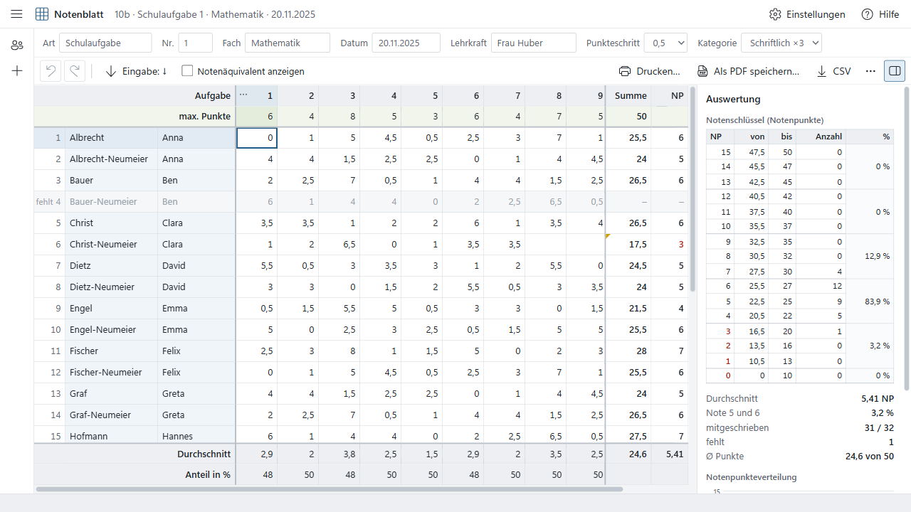
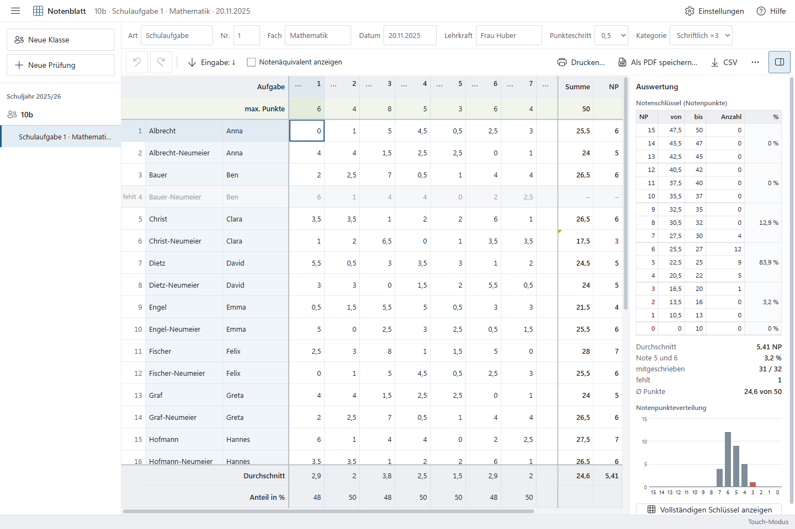
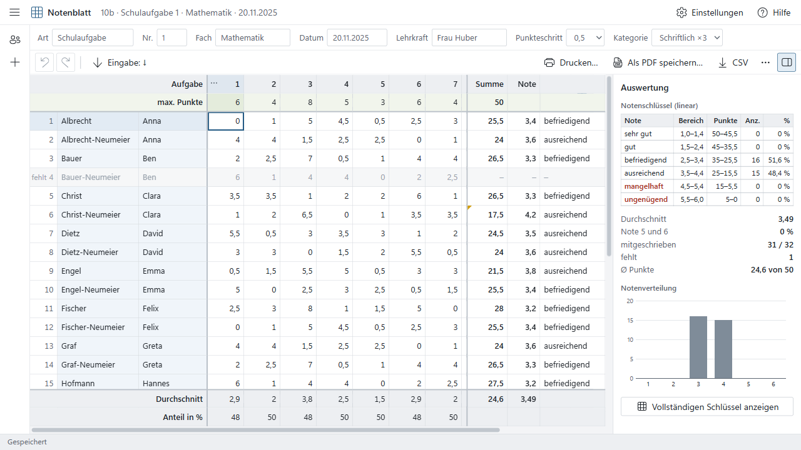
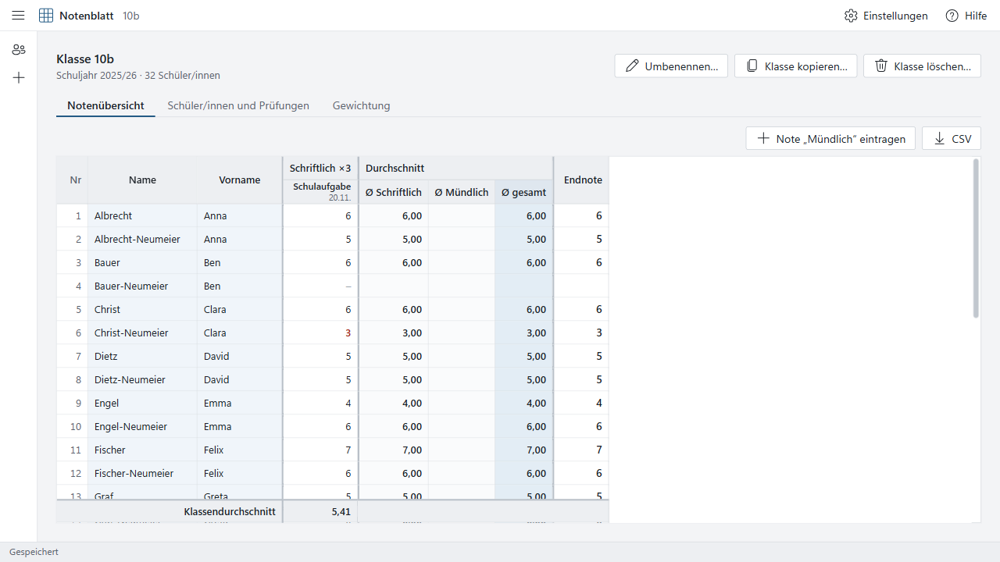
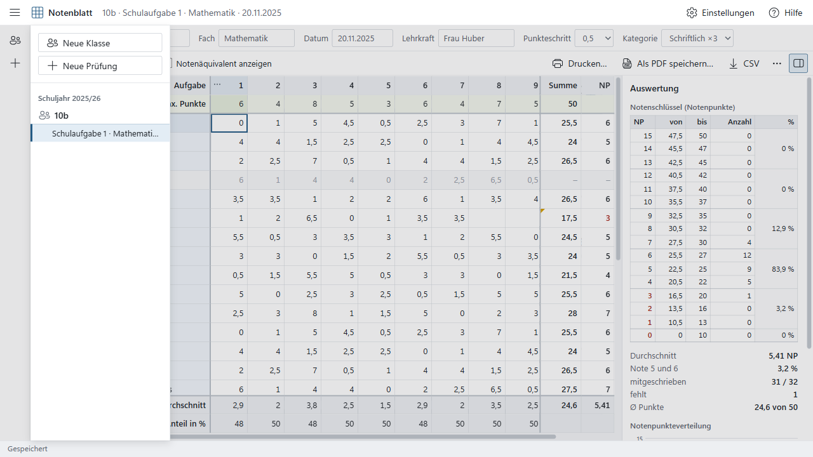
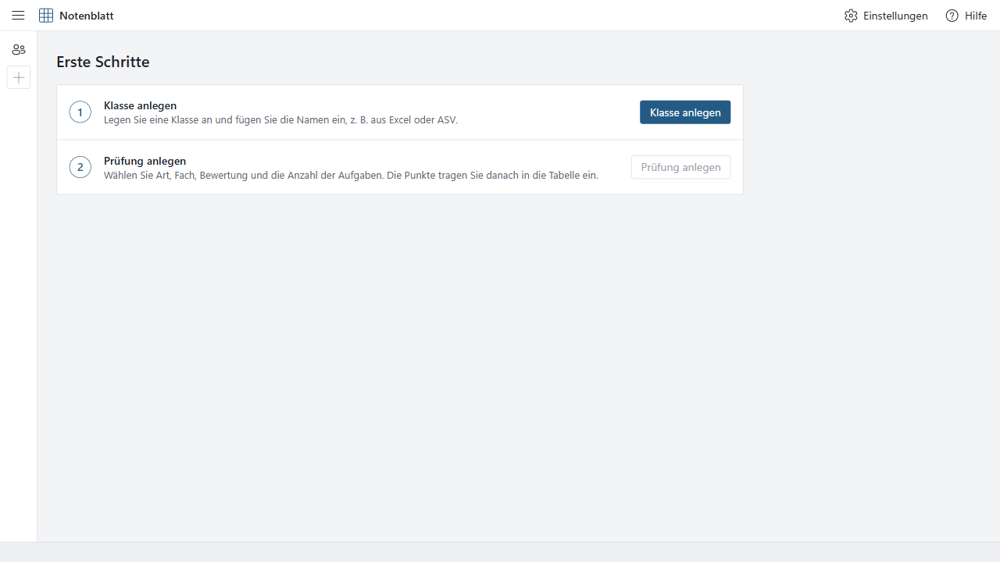

# Test report

Version 1.1.0 · Date: 2026-11-08 · Machine: Windows 11 Pro (x64), Node 22.23.4, Electron 45.2.3 (Node 24.22.2 inside), better-sqlite3 13.0.3 (SQLite 3.53.4).

## Summary

| Check | Command | Result |
|---|---|---|
| Lint (0 warnings) | `npm run lint` | ✅ pass |
| Typecheck (strict, 3 projects) | `npm run typecheck` | ✅ pass |
| Unit + integration | `npm test` | ✅ **112 / 112** passed (66 unit, 46 DB/storage integration) |
| Coverage `src/shared` | `npm run coverage` | ✅ lines 100 %, branches 96.54 %, functions 100 %, statements 99.78 % |
| End-to-end (Playwright + Electron) | `npm run e2e` | ✅ **6 / 6** passed (≈ 70 s) |
| Installer build | `npm run dist:win` | ✅ `Notenblatt-Setup-1.1.0-x64.exe` (122 MB), `Notenblatt-Setup-1.1.0-arm64.exe` (116 MB) |
| Packaged app, encrypted DB on another folder | `dist/win-unpacked/Notenblatt.exe` | ✅ move to folder → encrypt → restart → unlock → data and categories present; network log empty |
| CI (`windows-latest`) | `.github/workflows/ci.yml` | ⚠️ written, **not yet run** — the repository has not been pushed to GitHub |

## Version 1.1 additions

| File | Tests | Covers |
|---|---:|---|
| `tests/unit/overall.test.ts` | 12 | mark parsing (NP 0–15, linear 1,0–6,0 with one decimal, errors), formatting, mark statistics; weighted average per category and per exam, ignored/zero categories, **property test against an independent fraction computation** (1 500 runs); weights format/parse; overview builder (column order, sorting, absent, excluded exams with reasons, student missing in an exam); overview CSV; mark-only exam model and CSV |
| `tests/integration/storage.test.ts` | 15 | default WAL mode; move to a folder (old copy deleted, lock written, config updated, reopen from there); refuse overwrite / open an existing DB instead; move back to default; unreachable folder and missing DB (create here, use default); lock held by another device → "in use", takeover, running instance detects the takeover; foreign file change detected before overwrite; folder temporarily gone → change kept, retried by heartbeat; stale locks; **encryption**: no plaintext on disk, password required on start, wrong password rejected, change password, disable (back to WAL / plain snapshot on a folder), deleted names absent from the decrypted snapshot; backup import and wipe in snapshot mode; damaged plain snapshot renamed |
| `tests/integration/grading.test.ts` | 7 | migration v1 → v2 (categories added, exams assigned, grading system derived); template applies to new classes only; category add/update/move/delete rules (in use, last one, foreign class); copy class keeps weighting; template validation; mark-only exams (validation, no tasks, scheme locked while marks exist, absent, cascade on student delete, duplicate keeps mode); **overview with 3 : 1 weighting** (13,87), per-exam method (13,20), weight change (12,75), linear exam in NP class excluded |
| `tests/e2e/grading.spec.ts` | 1 | class from UI, template categories ×3/×1; written exam (points) by keyboard; oral marks via "Note „Mündlich“ eintragen" (invalid 16 rejected, undo/redo); overview Ø gesamt **14,00 / 5,25 / 11,00**; change weight → 13,00 / 7,50; per-exam method 12,33; template change affects only a new class; **encrypt** (file starts with `NBLTDB1`, no names in it); **move to another folder** (lock file present while open, removed on quit, old copy gone); restart → password prompt, wrong password rejected, data back; folder offline → "Speicherort nicht verfügbar" → retry |

Bugs found by these tests and fixed: missing-lock-file was misread as "taken over" when a share disappeared; category update with partial fields overwrote the name with `undefined`; inline fields committed only on blur (deferred while the window is unfocused); the lock was not released when the app was ended via `app.quit()`.

Screenshots: `docs/screenshots/overview-1440x900.png`, `oral-marks-1440x900.png`, `weighting-1440x900.png`, `settings-storage-1440x900.png`, `unlock-1440x900.png`.

**Not tested on real hardware/network:** an actual SMB network share (tests use a local folder and simulate disappearance/foreign writes), two physical devices at the same time, and sleep/resume of a device holding the lock.

## Vitest (version 1.0 baseline: 78 tests)

| File | Tests | Covers |
|---|---:|---|
| `tests/unit/engine.test.ts` | 27 | All golden values of §2.2/§3.6 (NP keys M = 55, 30, 37,5, 1, 0,5, 5, 999; linear M = 30, 7, 18,75); float regression 22/25, 44/50, 66/75 → 1,6; naive-float error count (24 for integer M ≤ 200, 32 incl. half-point M); **exhaustive comparison** with the independent BigInt reference for every M = 0,5…150 / P = 0…M at 0,5 steps (literal Excel formulation, ≥) and every M = 0,25…150 at 0,25 steps (strict >); key tables vs. direct grading for all M; properties with fast-check (monotonic, P = 0 → 0 NP/6,0, P = M → 15 NP/1,0, NP group ↔ Note column, linear ∈ [1,0; 6,0]) |
| `tests/unit/stats.test.ts` | 12 | Golden exam §3.6 in both schemes (participants 17, task averages/shares, Ø 15,6, distribution, 94,1 %/5,9 %, Ø 1,94 NP, 100 %; linear Ø 4,51, 10× mangelhaft / 7× ausreichend, 58,8 %); zero participants (no NaN/Infinity), all absent, one participant, partial row, unanswered task, all 0, all max, single task, 40 tasks; exam model texts; CSV (BOM, `;`, decimal comma, quoting) |
| `tests/unit/parse.test.ts` | 15 | Valid `"3,5" "3.5" " 3 " ",5" "3,50" "0"`; invalid `"-1" "abc" "1e2" "3,,5"`, `"3,25"` at step 0,5, `"7"` at max 6; empty deletes; format round-trip (property); dates; name-list parsing (comma/TAB/space, swap, duplicates); German collation; school year and retention; labels/file names |
| `tests/integration/db.test.ts` | 24 | Migrations on an empty DB + pragmas (WAL, foreign keys, secure_delete); cascades for student/exam/class delete with exact counts; late-joining student appears in existing exams; coarser step refused naming the first cell; task add/move/delete/restore; validation; **secure erasure** ("Zqxwvy Testperson" absent from `.db`, `-wal`, `-shm` in UTF-8, UTF-16LE and UTF-16BE after student delete, class delete and "Alle Daten löschen"); **backup round-trip** (export → wipe → import → identical); wrong password / damaged / wrong version / non-SQLite payload change nothing; **corrupted DB** renamed to `*.defekt-<timestamp>` and an empty DB starts |

### Coverage of `src/shared` (V8)

```
File            | % Stmts | % Branch | % Funcs | % Lines
All files       |   99.69 |    97.81 |     100 |     100
 shared/grading |     100 |    98.94 |     100 |     100
 shared/parse   |   98.86 |    94.66 |     100 |     100
 (all other shared files 100 %)
```

## End-to-end (Playwright `_electron`, production build)

| Test | Steps of §9.4 |
|---|---|
| `workflow.spec.ts` › complete workflow on an empty database | 1 empty start · 2 class + 20 names pasted (TAB, `"Nachname, Vorname"`, padded variants; German sort Jäger/Öztürk verified) · 3 exam with 8 tasks, 9 more added with "+", labels and max points of §3.6 entered by keyboard (M = 55) · 4 all §3.6 scores entered **by keyboard only**, Enter moving down each task column · 5 three students absent; every grid value, footer value, panel count/percentage/figure and all 16 key rows asserted · 6 linear scheme values asserted, switched back · 7 add / rename / move / delete task, undo ×4 / redo, confirmation for a task with 17 entries, cell undo/redo · 8 3×4 block paste (one undo step) and an invalid block rejected completely · 9 value above max and off-step value rejected with message · 13 PDF: file exists, starts with `%PDF-`, exactly **1 page** for 20 students · 14 CSV compared **byte by byte** (BOM, `;`, decimal comma, CRLF) · 10 restart: data persists, last exam reopens · 11 duplicate exam, delete a student → gone from both exams, statistics 16 / 19 · 12 class deletion with typed name · 16 network log empty · DB files contain no deleted names |
| `layout.spec.ts` › 1280×720 laptop | 32 students × 10 tasks: 30 px rows, no element outside the grid's scroll area overflows the window, after scrolling right and down the name column, Summe, NP, header row, max row and both footer rows are still on top (`elementFromPoint`); result columns pinned to the right edge before scrolling; keyboard navigation to the last cell keeps it visible; linear scheme; nav overlay; class view; settings |
| `layout.spec.ts` › 1440×960 Surface, touch mode | `.touch` active, 40 px rows, "⋯" always visible, toolbar hit targets ≥ 40 px, `inputmode="decimal"`, no overflow, sticky columns after scrolling |
| `data.spec.ts` › corrupted DB on start | garbage DB file → "Datenbank beschädigt" dialog, file renamed `notenblatt.db.defekt-YYYYMMDD-HHMMSS`, "Neu beginnen" leads to the start page |
| `data.spec.ts` › backup / wipe / import | personal-data warning, 8-character minimum, encrypted file (no plaintext names), "Alle Daten löschen" with typed LÖSCHEN (no names left in DB files), import with wrong password shows the error and changes nothing, correct password shows "1 Klasse, 1 Schüler, 0 Prüfungen" and restores |

Every E2E test ends by asserting that the main-process network log (`__nbNetLog`, filled by `session.webRequest.onBeforeRequest`) is empty.

## Screenshots

| | |
|---|---|
|  |  |
| Exam, NP scheme, 1280×720 | Exam, touch mode, 1440×960 |
|  |  |
| Linear scheme, scrolled right/down | Class view |
|  |  |
| Navigation overlay on a narrow window | First start |

Self-review against §7.1 (forbidden list): no gradients, blur, glow or large shadows (one shadow level for menus/dialogs only); no emoji, illustrations or AI icons; no oversized cards, pill badges or hero sections; accent `#245B85`, no purple/indigo/teal; no skeletons, animations, FABs or toasts (messages appear in the status bar). The printed PDFs (exam, Notenspiegel, Schlüssel; NP and linear) were checked visually: B/W-readable, hairlines and grey tints only.

## Manual Windows checks (§9.5)

| Check | Status | Notes |
|---|---|---|
| Install as standard user, no UAC | ✅ (silent mode) | Installer manifest `requestedExecutionLevel="asInvoker"` for x64 and arm64. Silent per-user install (`/S /D=…`) exited 0 without an elevation prompt; uninstall key written to **HKCU only** (none in HKLM); Start-menu shortcut created. The installed app started, created its DB and answered IPC; network log empty. The interactive wizard was not clicked through. |
| Uninstall, data checkbox unchecked (data remains) | ✅ (silent mode) | Silent uninstall exited 0; program files, HKCU key, Start-menu and desktop shortcuts removed. Silent mode never shows the checkbox page, so data is always kept, as for an unchecked box. |
| Uninstall, data checkbox checked (`%APPDATA%\Notenblatt` removed) | ⏳ **not yet performed** | Needs an interactive run of the uninstaller (page "Gespeicherte Daten"). Logic: `build/installer.nsh` → `RMDir /r "$APPDATA\Notenblatt"` when checked and not an update. |
| Start with network adapters disabled | ⏳ not performed manually | Not done on this machine. The app contains no network code, Chromium background networking is disabled, and every E2E run asserts zero non-local requests. |
| Surface touch walkthrough | ◐ emulated | No device available. Touch mode forced on at 1440×960 in the E2E test (40 px rows, always-visible "⋯", decimal keyboard hint); tapping (pointerType touch/pen) starts editing. |
| arm64 build | ◐ built, not run | Built with the arm64 N-API prebuild of better-sqlite3; no ARM device available to run it. |
